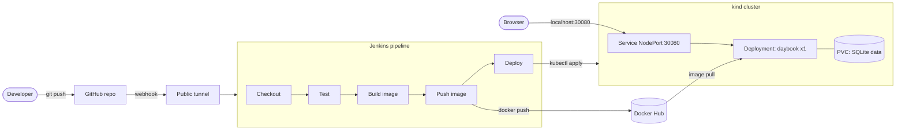

# Daybook

A calendar, task and planner web app, delivered through a fully automated CI/CD pipeline:
**GitHub → Jenkins → Docker Hub → Kubernetes (kind)**.

Every `git push` to `main` is tested, built into a versioned Docker image, pushed to Docker Hub and rolled out to the cluster with no manual steps.

## Architecture



## Tech stack

| Layer | Tool |
|---|---|
| Application | Python 3.12, Flask, SQLite, gunicorn |
| Tests | pytest |
| Containerization | Docker |
| Orchestration | Kubernetes (kind) |
| CI/CD | Jenkins (declarative pipeline) |
| Source control | Git, GitHub |
| Registry | Docker Hub (`kaching437/daybook`) |

## The application

| Page | Route | Purpose |
|---|---|---|
| Calendar | `/` | Weekly grid, today's agenda, upcoming events, task summary, quick add |
| My Tasks | `/tasks` | Create, edit, complete, delete, categorize, prioritize, filter |
| Planner | `/planner` | Schedule, edit and delete events |
| Health | `/health` | JSON status and version, used by Kubernetes probes |

All pages share one SQLite database, so a change on one page appears on the others. The sidebar footer shows the running version, which is the Jenkins build number in a deployed environment.

## Repository layout

```
daybook/
├── app.py                  Flask app factory and routes
├── requirements.txt        Runtime dependencies
├── requirements-dev.txt    Adds pytest
├── Dockerfile
├── Jenkinsfile             CI/CD pipeline definition
├── kind-config.yaml        Local cluster with port 30080 exposed
├── templates/              base, index, tasks, planner
├── static/                 css/style.css, js/calendar.js
├── tests/test_app.py
└── k8s/
    ├── deployment.yaml
    ├── service.yaml
    └── pvc.yaml
```

## Run it

**Locally**

```bash
python -m venv .venv && source .venv/bin/activate   # Windows: .venv\Scripts\activate
pip install -r requirements-dev.txt
pytest
python app.py                                        # http://localhost:5000
```

**In Docker**

```bash
docker build -t daybook:local --build-arg APP_VERSION=local .
docker run -d --name daybook -p 8080:5000 -v daybook-data:/data daybook:local
```

**On Kubernetes (kind)**

```bash
kind create cluster --name daybook --config kind-config.yaml
kubectl apply -f k8s/
kubectl rollout status deployment/daybook            # http://localhost:30080
```

## CI/CD pipeline

Defined in [`Jenkinsfile`](Jenkinsfile).

| Stage | What it does |
|---|---|
| Checkout | Pulls the latest commit from GitHub |
| Test | Creates a virtualenv and runs pytest. A failure stops the pipeline. |
| Build image | `docker build`, tagged with the build number, `APP_VERSION` baked in |
| Push image | Logs in with a Jenkins credential and pushes `kaching437/daybook:<build>` |
| Deploy | Applies the manifests with the new image tag and waits for the rollout to finish |

**Trigger:** a GitHub webhook (`/github-webhook/`) fires on every push, reaching Jenkins through a public tunnel.

**Jenkins setup**
- Credential `dockerhub-creds` (username and password) holds the Docker Hub login. Nothing secret is committed to the repo.
- Jenkins runs as the local user so it can reach Docker Desktop and the kind kubeconfig.
- Job type: Pipeline script from SCM, branch `main`, trigger "GitHub hook trigger for GITScm polling".

## Design decisions

- **Versioned images.** Each build is tagged with its build number, so every deployment is traceable and can be rolled back with `kubectl rollout undo`.
- **Deploy only after a successful push.** The Deploy stage runs last, so the cluster never references an image that doesn't exist.
- **Manifests stay the source of truth.** Jenkins rewrites only the image tag at deploy time and applies the rest unchanged, giving a single rollout per build.
- **Single replica with `Recreate` strategy.** SQLite allows one writer, so the old pod stops before the new one starts.
- **Persistent volume.** The database lives on a PVC, so data survives pod restarts and redeployments.
- **Probes.** Readiness and liveness checks use `/health`, so traffic only reaches a healthy pod.
- **Non-root container** with a slim base image and a `.dockerignore` to keep the image small.
- **Input handling.** Server-side validation of categories, priorities, dates and times, and a redirect guard against open redirects.

## Known limitations and next steps

- SQLite limits the app to one replica. Moving to PostgreSQL would allow horizontal scaling and rolling updates.
- The webhook relies on a temporary tunnel. A hosted Jenkins with a stable URL would remove that.
- Add an Ingress with TLS instead of a NodePort.
- Add image vulnerability scanning and a linting stage to the pipeline.
- Use a Docker Hub access token instead of the account password.